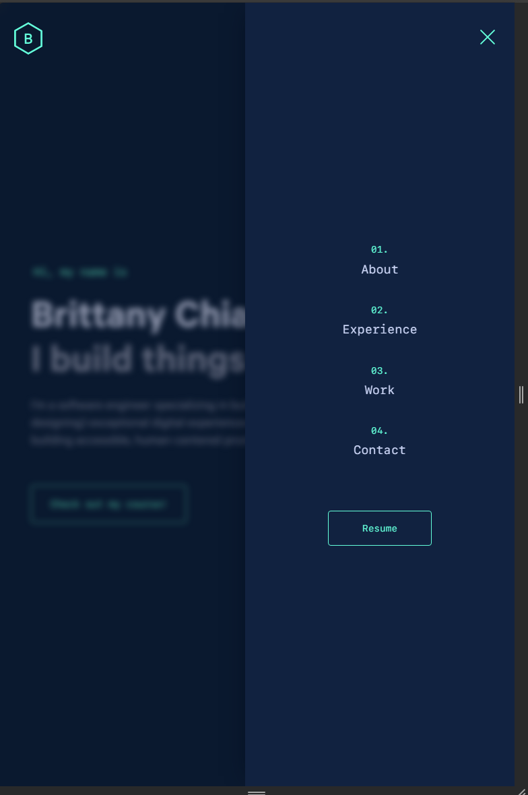
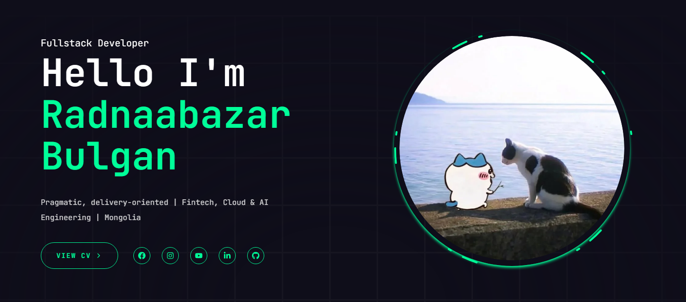
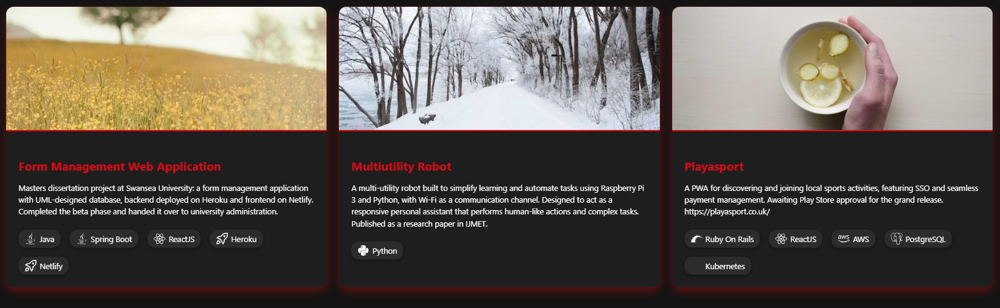
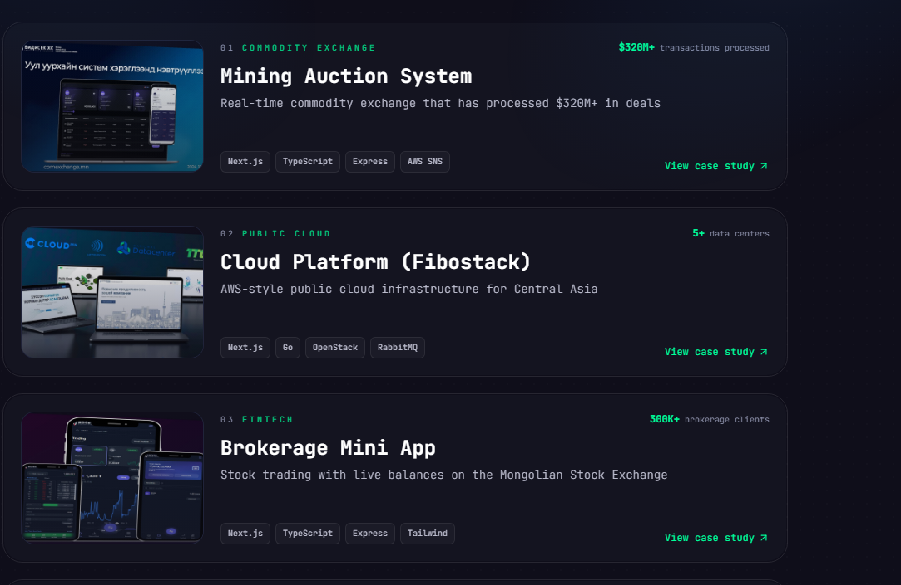
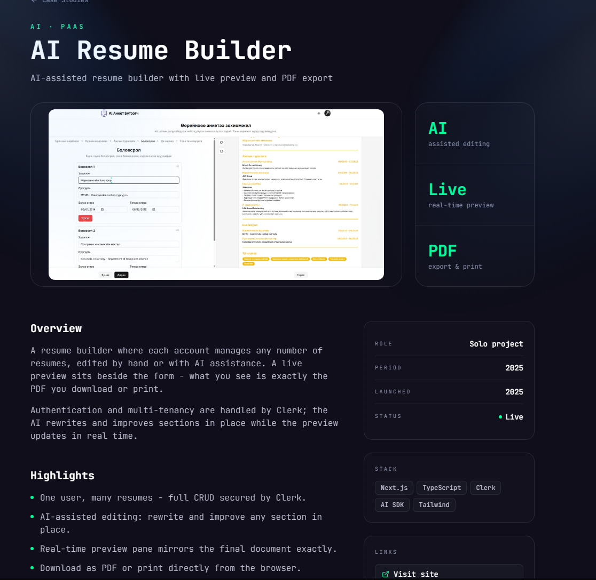
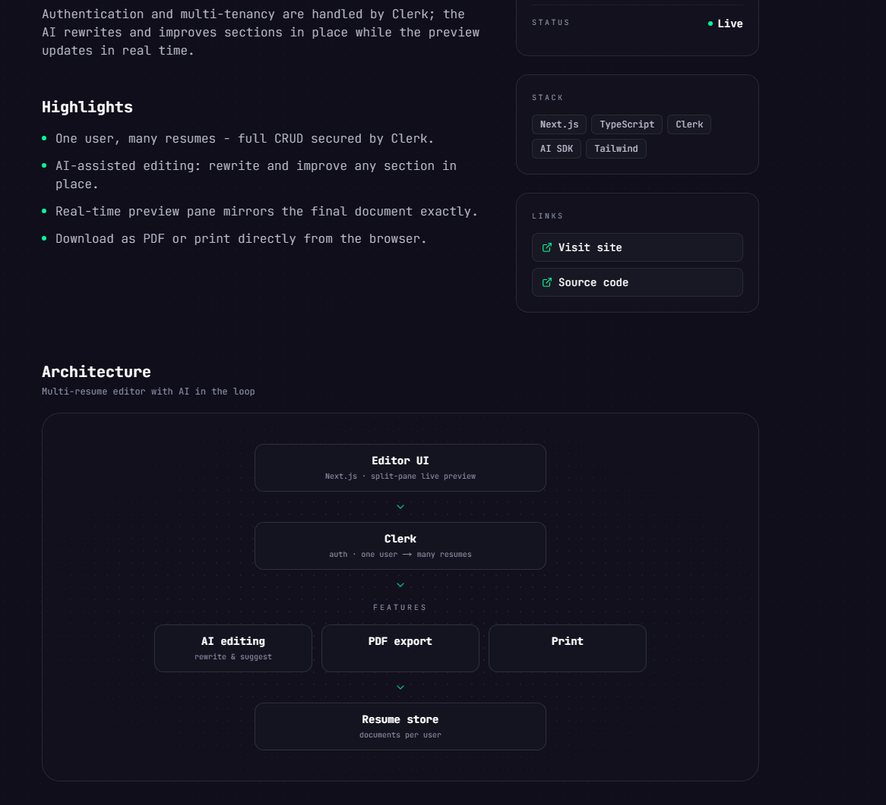

# Completed Frontend Changes

Everything here was moved out of [Frontend Changes.md](Frontend%20Changes.md) once it was fully done.

## General

- each Core section(Home, Games, Tools, Projects) should have their own colors(shadcn style)

## Nav

- Nav Bar should have 6 things on it
  - Home(Will be Krish544 or logo on leftmost side)
  - Account
  - Games
  - Tools
  - Projects
  - Resume
- Nav will be stuck to the top of the screen, but be a little translucent
- Steal mobile version of nav bar from https://v4.brittanychiang.com
  
- Whatever is the current page should be highlighted on navbar
- On hover colors should change to Primary color of that section(for Resume again steal the button from https://v4.brittanychiang.com )
- Nav should be background color with a little shadow to tell it's not fully part of page(steal from comet aviation)

## Home

- Home should have jolteon colors
- Should have an introduction of myself like https://www.radnaabazar.com/en/personal
- Account related things should follow Home color scheme
- Frontpage should have (in order)
  - Header/Summary of who I am(like https://www.radnaabazar.com/en/personal)

## Games

- Current Card Setup is fine, but lets remove the Video Part and make the thumbnails change based on light and dark mode
- add some drop shadow thats the primary color of the section and make it bigger/higher opacity on hover like https://sumanthsamala.com/projects
  

## Tools

- Current Card Setup is fine, but lets remove the Video Part and make the thumbnails change based on light and dark mode
- add some drop shadow thats the primary color of the section and make it bigger/higher opacity on hover like https://sumanthsamala.com/projects
  

## Projects

- Show each project with a picture of it, a short summary, and shown tech stack exactly like https://www.radnaabazar.com/en/projects
  
  Don't put any of the top right corner stats for card
- Also since these are outside projects each one should have their own little case study like https://www.radnaabazar.com/en/projects/brokerage-mini-app
  - 
  - 
- have it grided on desktop(lg) and just one column on mobile
- Make sure that it's easy to make a new project using the config
- There shouldn't be a separate jsx/tsx file for each project, it should be reusable for each following the eariler shown example barring the parts not explicitly in the projectsConfig.ts file
- THESE LOOK DIFFERENT THAN TOOLS AND GAMES

## Footer

- On the bottom of every page below comments
- Social Links
- Made by Krish Bharal on the bottom of the page

## To-do List

### QOL

- add borders to things like comments and login to separate from background
- make case study cards have some reaction on hover

### Optional extras

- on click swap it to a picture of me actually
