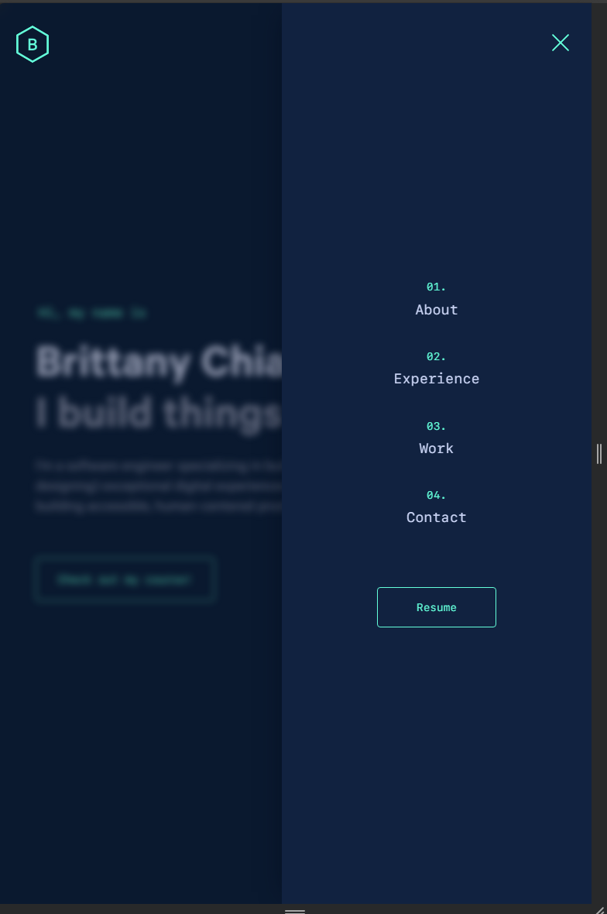
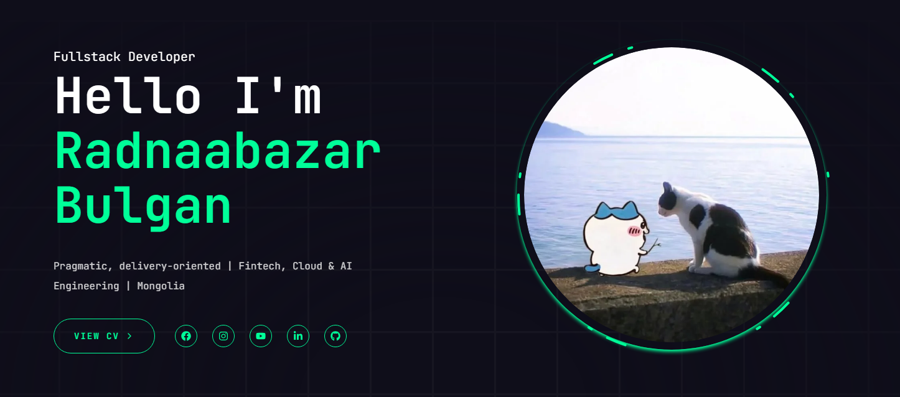
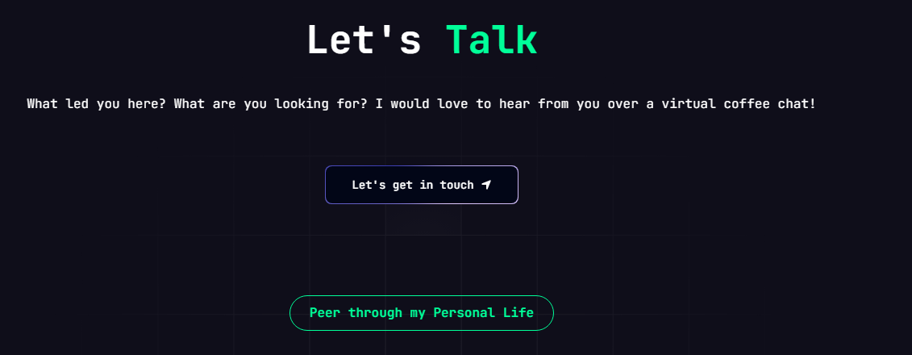
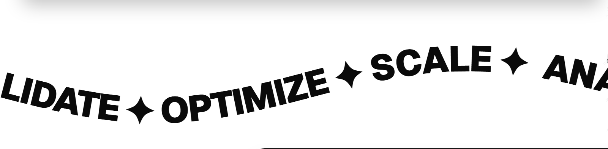
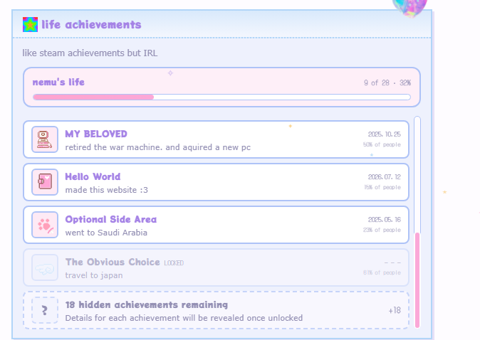
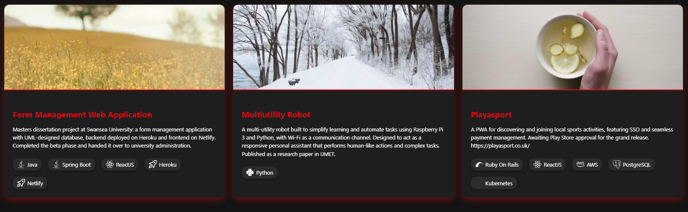
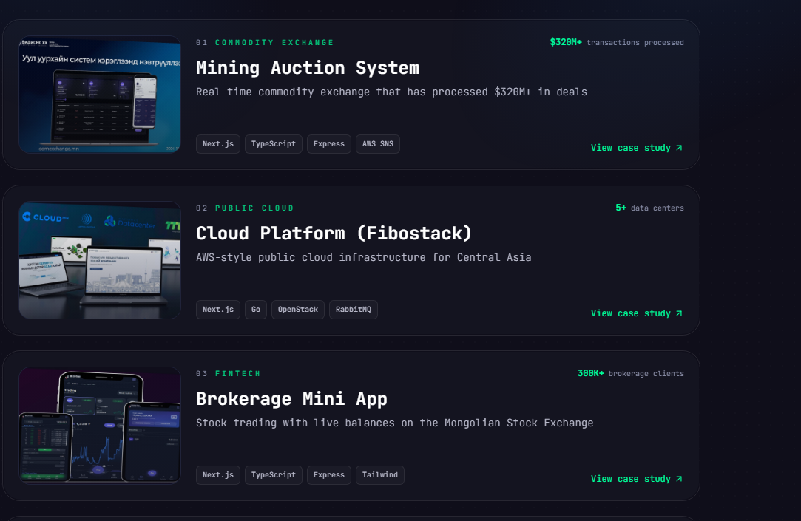
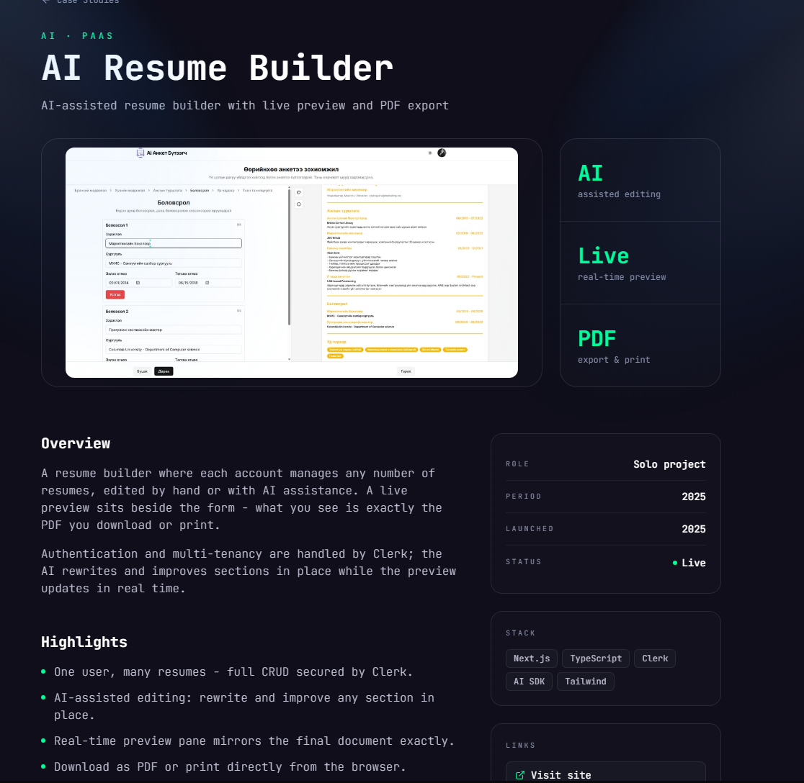
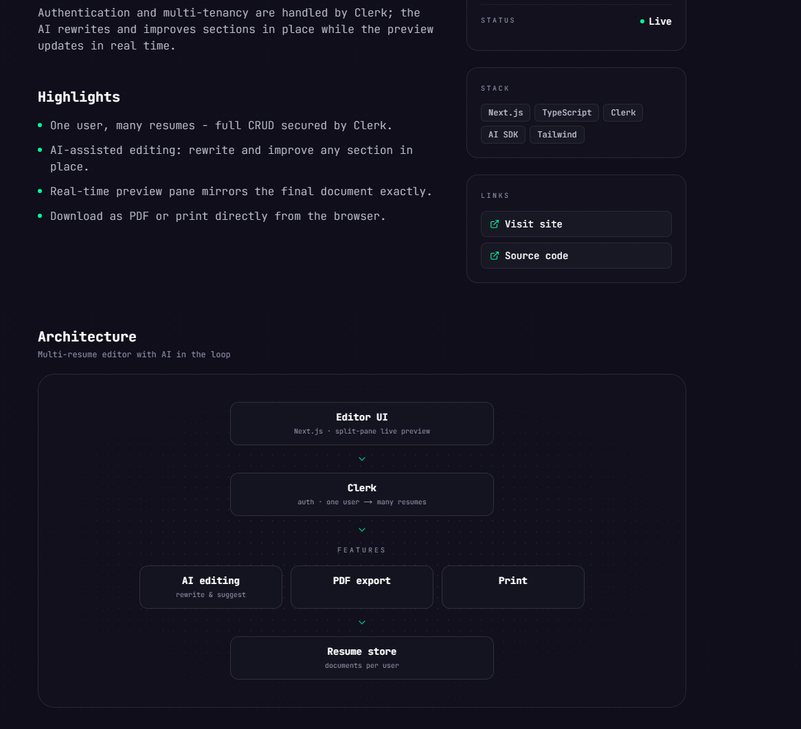
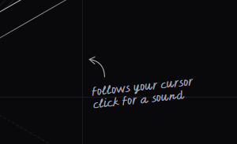

# Plans for new Frontend

## General

- each Core section(Home, Games, Tools, Projects) should have their own colors(shadcn style)
- each Core section should have a unique animation/transition to it
- Every component should be reusable and not hard coded

## Nav

- Nav Bar should have 6 things on it
  - Home(Will be Krish544 or logo on leftmost side)
  - Account
  - Games
  - Tools
  - Projects
  - Resume
- Nav will be stuck to the top of the screen, but be a little translucent
- Steal mobile version of nav bar from https://v4.brittanychiang.com
  
- Whatever is the current page should be highlighted on navbar
- On hover colors should change to Primary color of that section(for Resume again steal the button from https://v4.brittanychiang.com )
- Nav should be background color with a little shadow to tell it's not fully part of page(steal from comet aviation)

## Home

- On inital load of Home page animation of Jolteon getting zapped and turning into plush jolteon
- transition is a 5 star pull animation(probably going to be wuthering waves or genshin impact's) that ends with pulling jolteon plush splash art before clearing for the actual page
- Home should have jolteon colors
- Should have an introduction of myself like https://www.radnaabazar.com/en/personal
- Account related things should follow Home color scheme
- Frontpage should have (in order)
  - Header/Summary of who I am(like https://www.radnaabazar.com/en/personal)
  - About Me(might make into a bento instead)
  - Skills(use skills rework)
  - Projects(Link and display last 4 added projects)
  - Work history
  - Some of my Writings, the blog: "Want to know more? here's my blog!" -> Link/index of Blog(like https://blog.maximeheckel.com) probably for later down the line when I actually start writing
  - Contact me Area(not just the footer)
    end of page will look like this 
  - Link to Personal Homepage
- Side of Homepage has this element vertical with different words

```
<svg viewBox="0 0 1440 240" class="w-full select-none " style="cursor: grab; touch-action: pan-y;"><text aria-hidden="true" style="visibility: hidden; font-family: inherit; font-weight: 900; text-transform: uppercase; letter-spacing: -0.02em; font-size: 84px;"><textPath href="#curve-_r_7_">&nbsp;ANALYZE&nbsp;✦&nbsp;DESIGN&nbsp;✦&nbsp;BUILD&nbsp;✦&nbsp;VALIDATE&nbsp;✦&nbsp;OPTIMIZE&nbsp;✦&nbsp;SCALE&nbsp;✦&nbsp;</textPath></text><path id="curve-_r_7_" d="M-4500.000,107.574 L-4488.000,109.852 L-4476.000,112.241 L-4464.000,114.733 L-4452.000,117.322 L-4440.000,120.000 L-4428.000,122.761 L-4416.000,125.596 L-4404.000,128.498 L-4392.000,131.459 L-4380.000,134.471 L-4368.000,137.525 L-4356.000,140.614 L-4344.000,143.728 L-4332.000,146.860 L-4320.000,150.000 L-4308.000,153.140 L-4296.000,156.272 L-4284.000,159.386 L-4272.000,162.475 L-4260.000,165.529 L-4248.000,168.541 L-4236.000,171.502 L-4224.000,174.404 L-4212.000,177.239 L-4200.000,180.000 L-4188.000,182.678 L-4176.000,185.267 L-4164.000,187.759 L-4152.000,190.148 L-4140.000,192.426 L-4128.000,194.589 L-4116.000,196.629 L-4104.000,198.541 L-4092.000,200.320 L-4080.000,201.962 L-4068.000,203.460 L-4056.000,204.813 L-4044.000,206.015 L-4032.000,207.063 L-4020.000,207.956 L-4008.000,208.689 L-3996.000,209.261 L-3984.000,209.671 L-3972.000,209.918 L-3960.000,210.000 L-3948.000,209.918 L-3936.000,209.671 L-3924.000,209.261 L-3912.000,208.689 L-3900.000,207.956 L-3888.000,207.063 L-3876.000,206.015 L-3864.000,204.813 L-3852.000,203.460 L-3840.000,201.962 L-3828.000,200.320 L-3816.000,198.541 L-3804.000,196.629 L-3792.000,194.589 L-3780.000,192.426 L-3768.000,190.148 L-3756.000,187.759 L-3744.000,185.267 L-3732.000,182.678 L-3720.000,180.000 L-3708.000,177.239 L-3696.000,174.404 L-3684.000,171.502 L-3672.000,168.541 L-3660.000,165.529 L-3648.000,162.475 L-3636.000,159.386 L-3624.000,156.272 L-3612.000,153.140 L-3600.000,150.000 L-3588.000,146.860 L-3576.000,143.728 L-3564.000,140.614 L-3552.000,137.525 L-3540.000,134.471 L-3528.000,131.459 L-3516.000,128.498 L-3504.000,125.596 L-3492.000,122.761 L-3480.000,120.000 L-3468.000,117.322 L-3456.000,114.733 L-3444.000,112.241 L-3432.000,109.852 L-3420.000,107.574 L-3408.000,105.411 L-3396.000,103.371 L-3384.000,101.459 L-3372.000,99.680 L-3360.000,98.038 L-3348.000,96.540 L-3336.000,95.187 L-3324.000,93.985 L-3312.000,92.937 L-3300.000,92.044 L-3288.000,91.311 L-3276.000,90.739 L-3264.000,90.329 L-3252.000,90.082 L-3240.000,90.000 L-3228.000,90.082 L-3216.000,90.329 L-3204.000,90.739 L-3192.000,91.311 L-3180.000,92.044 L-3168.000,92.937 L-3156.000,93.985 L-3144.000,95.187 L-3132.000,96.540 L-3120.000,98.038 L-3108.000,99.680 L-3096.000,101.459 L-3084.000,103.371 L-3072.000,105.411 L-3060.000,107.574 L-3048.000,109.852 L-3036.000,112.241 L-3024.000,114.733 L-3012.000,117.322 L-3000.000,120.000 L-2988.000,122.761 L-2976.000,125.596 L-2964.000,128.498 L-2952.000,131.459 L-2940.000,134.471 L-2928.000,137.525 L-2916.000,140.614 L-2904.000,143.728 L-2892.000,146.860 L-2880.000,150.000 L-2868.000,153.140 L-2856.000,156.272 L-2844.000,159.386 L-2832.000,162.475 L-2820.000,165.529 L-2808.000,168.541 L-2796.000,171.502 L-2784.000,174.404 L-2772.000,177.239 L-2760.000,180.000 L-2748.000,182.678 L-2736.000,185.267 L-2724.000,187.759 L-2712.000,190.148 L-2700.000,192.426 L-2688.000,194.589 L-2676.000,196.629 L-2664.000,198.541 L-2652.000,200.320 L-2640.000,201.962 L-2628.000,203.460 L-2616.000,204.813 L-2604.000,206.015 L-2592.000,207.063 L-2580.000,207.956 L-2568.000,208.689 L-2556.000,209.261 L-2544.000,209.671 L-2532.000,209.918 L-2520.000,210.000 L-2508.000,209.918 L-2496.000,209.671 L-2484.000,209.261 L-2472.000,208.689 L-2460.000,207.956 L-2448.000,207.063 L-2436.000,206.015 L-2424.000,204.813 L-2412.000,203.460 L-2400.000,201.962 L-2388.000,200.320 L-2376.000,198.541 L-2364.000,196.629 L-2352.000,194.589 L-2340.000,192.426 L-2328.000,190.148 L-2316.000,187.759 L-2304.000,185.267 L-2292.000,182.678 L-2280.000,180.000 L-2268.000,177.239 L-2256.000,174.404 L-2244.000,171.502 L-2232.000,168.541 L-2220.000,165.529 L-2208.000,162.475 L-2196.000,159.386 L-2184.000,156.272 L-2172.000,153.140 L-2160.000,150.000 L-2148.000,146.860 L-2136.000,143.728 L-2124.000,140.614 L-2112.000,137.525 L-2100.000,134.471 L-2088.000,131.459 L-2076.000,128.498 L-2064.000,125.596 L-2052.000,122.761 L-2040.000,120.000 L-2028.000,117.322 L-2016.000,114.733 L-2004.000,112.241 L-1992.000,109.852 L-1980.000,107.574 L-1968.000,105.411 L-1956.000,103.371 L-1944.000,101.459 L-1932.000,99.680 L-1920.000,98.038 L-1908.000,96.540 L-1896.000,95.187 L-1884.000,93.985 L-1872.000,92.937 L-1860.000,92.044 L-1848.000,91.311 L-1836.000,90.739 L-1824.000,90.329 L-1812.000,90.082 L-1800.000,90.000 L-1788.000,90.082 L-1776.000,90.329 L-1764.000,90.739 L-1752.000,91.311 L-1740.000,92.044 L-1728.000,92.937 L-1716.000,93.985 L-1704.000,95.187 L-1692.000,96.540 L-1680.000,98.038 L-1668.000,99.680 L-1656.000,101.459 L-1644.000,103.371 L-1632.000,105.411 L-1620.000,107.574 L-1608.000,109.852 L-1596.000,112.241 L-1584.000,114.733 L-1572.000,117.322 L-1560.000,120.000 L-1548.000,122.761 L-1536.000,125.596 L-1524.000,128.498 L-1512.000,131.459 L-1500.000,134.471 L-1488.000,137.525 L-1476.000,140.614 L-1464.000,143.728 L-1452.000,146.860 L-1440.000,150.000 L-1428.000,153.140 L-1416.000,156.272 L-1404.000,159.386 L-1392.000,162.475 L-1380.000,165.529 L-1368.000,168.541 L-1356.000,171.502 L-1344.000,174.404 L-1332.000,177.239 L-1320.000,180.000 L-1308.000,182.678 L-1296.000,185.267 L-1284.000,187.759 L-1272.000,190.148 L-1260.000,192.426 L-1248.000,194.589 L-1236.000,196.629 L-1224.000,198.541 L-1212.000,200.320 L-1200.000,201.962 L-1188.000,203.460 L-1176.000,204.813 L-1164.000,206.015 L-1152.000,207.063 L-1140.000,207.956 L-1128.000,208.689 L-1116.000,209.261 L-1104.000,209.671 L-1092.000,209.918 L-1080.000,210.000 L-1068.000,209.918 L-1056.000,209.671 L-1044.000,209.261 L-1032.000,208.689 L-1020.000,207.956 L-1008.000,207.063 L-996.000,206.015 L-984.000,204.813 L-972.000,203.460 L-960.000,201.962 L-948.000,200.320 L-936.000,198.541 L-924.000,196.629 L-912.000,194.589 L-900.000,192.426 L-888.000,190.148 L-876.000,187.759 L-864.000,185.267 L-852.000,182.678 L-840.000,180.000 L-828.000,177.239 L-816.000,174.404 L-804.000,171.502 L-792.000,168.541 L-780.000,165.529 L-768.000,162.475 L-756.000,159.386 L-744.000,156.272 L-732.000,153.140 L-720.000,150.000 L-708.000,146.860 L-696.000,143.728 L-684.000,140.614 L-672.000,137.525 L-660.000,134.471 L-648.000,131.459 L-636.000,128.498 L-624.000,125.596 L-612.000,122.761 L-600.000,120.000 L-588.000,117.322 L-576.000,114.733 L-564.000,112.241 L-552.000,109.852 L-540.000,107.574 L-528.000,105.411 L-516.000,103.371 L-504.000,101.459 L-492.000,99.680 L-480.000,98.038 L-468.000,96.540 L-456.000,95.187 L-444.000,93.985 L-432.000,92.937 L-420.000,92.044 L-408.000,91.311 L-396.000,90.739 L-384.000,90.329 L-372.000,90.082 L-360.000,90.000 L-348.000,90.082 L-336.000,90.329 L-324.000,90.739 L-312.000,91.311 L-300.000,92.044 L-288.000,92.937 L-276.000,93.985 L-264.000,95.187 L-252.000,96.540 L-240.000,98.038 L-228.000,99.680 L-216.000,101.459 L-204.000,103.371 L-192.000,105.411 L-180.000,107.574 L-168.000,109.852 L-156.000,112.241 L-144.000,114.733 L-132.000,117.322 L-120.000,120.000 L-108.000,122.761 L-96.000,125.596 L-84.000,128.498 L-72.000,131.459 L-60.000,134.471 L-48.000,137.525 L-36.000,140.614 L-24.000,143.728 L-12.000,146.860 L0.000,150.000 L12.000,153.140 L24.000,156.272 L36.000,159.386 L48.000,162.475 L60.000,165.529 L72.000,168.541 L84.000,171.502 L96.000,174.404 L108.000,177.239 L120.000,180.000 L132.000,182.678 L144.000,185.267 L156.000,187.759 L168.000,190.148 L180.000,192.426 L192.000,194.589 L204.000,196.629 L216.000,198.541 L228.000,200.320 L240.000,201.962 L252.000,203.460 L264.000,204.813 L276.000,206.015 L288.000,207.063 L300.000,207.956 L312.000,208.689 L324.000,209.261 L336.000,209.671 L348.000,209.918 L360.000,210.000 L372.000,209.918 L384.000,209.671 L396.000,209.261 L408.000,208.689 L420.000,207.956 L432.000,207.063 L444.000,206.015 L456.000,204.813 L468.000,203.460 L480.000,201.962 L492.000,200.320 L504.000,198.541 L516.000,196.629 L528.000,194.589 L540.000,192.426 L552.000,190.148 L564.000,187.759 L576.000,185.267 L588.000,182.678 L600.000,180.000 L612.000,177.239 L624.000,174.404 L636.000,171.502 L648.000,168.541 L660.000,165.529 L672.000,162.475 L684.000,159.386 L696.000,156.272 L708.000,153.140 L720.000,150.000 L732.000,146.860 L744.000,143.728 L756.000,140.614 L768.000,137.525 L780.000,134.471 L792.000,131.459 L804.000,128.498 L816.000,125.596 L828.000,122.761 L840.000,120.000 L852.000,117.322 L864.000,114.733 L876.000,112.241 L888.000,109.852 L900.000,107.574 L912.000,105.411 L924.000,103.371 L936.000,101.459 L948.000,99.680 L960.000,98.038 L972.000,96.540 L984.000,95.187 L996.000,93.985 L1008.000,92.937 L1020.000,92.044 L1032.000,91.311 L1044.000,90.739 L1056.000,90.329 L1068.000,90.082 L1080.000,90.000 L1092.000,90.082 L1104.000,90.329 L1116.000,90.739 L1128.000,91.311 L1140.000,92.044 L1152.000,92.937 L1164.000,93.985 L1176.000,95.187 L1188.000,96.540 L1200.000,98.038 L1212.000,99.680 L1224.000,101.459 L1236.000,103.371 L1248.000,105.411 L1260.000,107.574 L1272.000,109.852 L1284.000,112.241 L1296.000,114.733 L1308.000,117.322 L1320.000,120.000 L1332.000,122.761 L1344.000,125.596 L1356.000,128.498 L1368.000,131.459 L1380.000,134.471 L1392.000,137.525 L1404.000,140.614 L1416.000,143.728 L1428.000,146.860 L1440.000,150.000 L1452.000,153.140 L1464.000,156.272 L1476.000,159.386 L1488.000,162.475 L1500.000,165.529 L1512.000,168.541 L1524.000,171.502 L1536.000,174.404 L1548.000,177.239 L1560.000,180.000 L1572.000,182.678 L1584.000,185.267 L1596.000,187.759 L1608.000,190.148 L1620.000,192.426 L1632.000,194.589 L1644.000,196.629 L1656.000,198.541 L1668.000,200.320 L1680.000,201.962 L1692.000,203.460 L1704.000,204.813 L1716.000,206.015 L1728.000,207.063 L1740.000,207.956 L1752.000,208.689 L1764.000,209.261 L1776.000,209.671 L1788.000,209.918 L1800.000,210.000 L1812.000,209.918 L1824.000,209.671 L1836.000,209.261 L1848.000,208.689 L1860.000,207.956 L1872.000,207.063 L1884.000,206.015 L1896.000,204.813 L1908.000,203.460 L1920.000,201.962 L1932.000,200.320 L1944.000,198.541 L1956.000,196.629 L1968.000,194.589 L1980.000,192.426 L1992.000,190.148 L2004.000,187.759 L2016.000,185.267 L2028.000,182.678 L2040.000,180.000 L2052.000,177.239 L2064.000,174.404 L2076.000,171.502 L2088.000,168.541 L2100.000,165.529 L2112.000,162.475 L2124.000,159.386 L2136.000,156.272 L2148.000,153.140 L2160.000,150.000 L2172.000,146.860 L2184.000,143.728 L2196.000,140.614 L2208.000,137.525 L2220.000,134.471 L2232.000,131.459 L2244.000,128.498 L2256.000,125.596 L2268.000,122.761 L2280.000,120.000 L2292.000,117.322 L2304.000,114.733 L2316.000,112.241 L2328.000,109.852 L2340.000,107.574 L2352.000,105.411 L2364.000,103.371 L2376.000,101.459 L2388.000,99.680 L2400.000,98.038 L2412.000,96.540 L2424.000,95.187 L2436.000,93.985 L2448.000,92.937 L2460.000,92.044 L2472.000,91.311 L2484.000,90.739 L2496.000,90.329 L2508.000,90.082 L2520.000,90.000 L2532.000,90.082 L2544.000,90.329 L2556.000,90.739 L2568.000,91.311 L2580.000,92.044 L2592.000,92.937 L2604.000,93.985 L2616.000,95.187 L2628.000,96.540 L2640.000,98.038 L2652.000,99.680 L2664.000,101.459 L2676.000,103.371 L2688.000,105.411 L2700.000,107.574 L2712.000,109.852 L2724.000,112.241 L2736.000,114.733 L2748.000,117.322 L2760.000,120.000 L2772.000,122.761 L2784.000,125.596 L2796.000,128.498 L2808.000,131.459 L2820.000,134.471 L2832.000,137.525 L2844.000,140.614 L2856.000,143.728 L2868.000,146.860 L2880.000,150.000 L2892.000,153.140 L2904.000,156.272 L2916.000,159.386 L2928.000,162.475 L2940.000,165.529 L2952.000,168.541 L2964.000,171.502 L2976.000,174.404 L2988.000,177.239 L3000.000,180.000 L3012.000,182.678 L3024.000,185.267 L3036.000,187.759 L3048.000,190.148 L3060.000,192.426 L3072.000,194.589 L3084.000,196.629 L3096.000,198.541 L3108.000,200.320 L3120.000,201.962 L3132.000,203.460 L3144.000,204.813 L3156.000,206.015 L3168.000,207.063 L3180.000,207.956 L3192.000,208.689 L3204.000,209.261 L3216.000,209.671 L3228.000,209.918 L3240.000,210.000 L3252.000,209.918 L3264.000,209.671 L3276.000,209.261 L3288.000,208.689 L3300.000,207.956 L3312.000,207.063 L3324.000,206.015 L3336.000,204.813 L3348.000,203.460 L3360.000,201.962 L3372.000,200.320 L3384.000,198.541 L3396.000,196.629 L3408.000,194.589 L3420.000,192.426 L3432.000,190.148 L3444.000,187.759 L3456.000,185.267 L3468.000,182.678 L3480.000,180.000 L3492.000,177.239 L3504.000,174.404 L3516.000,171.502 L3528.000,168.541 L3540.000,165.529 L3552.000,162.475 L3564.000,159.386 L3576.000,156.272 L3588.000,153.140 L3600.000,150.000 L3612.000,146.860 L3624.000,143.728 L3636.000,140.614 L3648.000,137.525 L3660.000,134.471 L3672.000,131.459 L3684.000,128.498 L3696.000,125.596 L3708.000,122.761 L3720.000,120.000 L3732.000,117.322 L3744.000,114.733 L3756.000,112.241 L3768.000,109.852 L3780.000,107.574 L3792.000,105.411 L3804.000,103.371 L3816.000,101.459 L3828.000,99.680 L3840.000,98.038 L3852.000,96.540 L3864.000,95.187 L3876.000,93.985 L3888.000,92.937 L3900.000,92.044 L3912.000,91.311 L3924.000,90.739 L3936.000,90.329 L3948.000,90.082 L3960.000,90.000 L3972.000,90.082 L3984.000,90.329 L3996.000,90.739 L4008.000,91.311 L4020.000,92.044 L4032.000,92.937 L4044.000,93.985 L4056.000,95.187 L4068.000,96.540 L4080.000,98.038 L4092.000,99.680 L4104.000,101.459 L4116.000,103.371 L4128.000,105.411 L4140.000,107.574 L4152.000,109.852 L4164.000,112.241 L4176.000,114.733 L4188.000,117.322 L4200.000,120.000 L4212.000,122.761 L4224.000,125.596 L4236.000,128.498 L4248.000,131.459 L4260.000,134.471 L4272.000,137.525 L4284.000,140.614 L4296.000,143.728 L4308.000,146.860 L4320.000,150.000 L4332.000,153.140 L4344.000,156.272 L4356.000,159.386 L4368.000,162.475 L4380.000,165.529 L4392.000,168.541 L4404.000,171.502 L4416.000,174.404 L4428.000,177.239 L4440.000,180.000 L4452.000,182.678 L4464.000,185.267 L4476.000,187.759 L4488.000,190.148 L4500.000,192.426" fill="none" stroke="none"></path><text xml:space="preserve" fill="currentColor" class="text-foreground" style="font-family: inherit; font-weight: 900; text-transform: uppercase; letter-spacing: -0.02em; font-size: 84px;"><textPath href="#curve-_r_7_" startOffset="3853.926904296935px">&nbsp;ANALYZE&nbsp;✦&nbsp;DESIGN&nbsp;✦&nbsp;BUILD&nbsp;✦&nbsp;VALIDATE&nbsp;✦&nbsp;OPTIMIZE&nbsp;✦&nbsp;SCALE&nbsp;✦&nbsp;&nbsp;ANALYZE&nbsp;✦&nbsp;DESIGN&nbsp;✦&nbsp;BUILD&nbsp;✦&nbsp;VALIDATE&nbsp;✦&nbsp;OPTIMIZE&nbsp;✦&nbsp;SCALE&nbsp;✦&nbsp;&nbsp;ANALYZE&nbsp;✦&nbsp;DESIGN&nbsp;✦&nbsp;BUILD&nbsp;✦&nbsp;VALIDATE&nbsp;✦&nbsp;OPTIMIZE&nbsp;✦&nbsp;SCALE&nbsp;✦&nbsp;&nbsp;ANALYZE&nbsp;✦&nbsp;DESIGN&nbsp;✦&nbsp;BUILD&nbsp;✦&nbsp;VALIDATE&nbsp;✦&nbsp;OPTIMIZE&nbsp;✦&nbsp;SCALE&nbsp;✦&nbsp;&nbsp;ANALYZE&nbsp;✦&nbsp;DESIGN&nbsp;✦&nbsp;BUILD&nbsp;✦&nbsp;VALIDATE&nbsp;✦&nbsp;OPTIMIZE&nbsp;✦&nbsp;SCALE&nbsp;✦&nbsp;&nbsp;ANALYZE&nbsp;✦&nbsp;DESIGN&nbsp;✦&nbsp;BUILD&nbsp;✦&nbsp;VALIDATE&nbsp;✦&nbsp;OPTIMIZE&nbsp;✦&nbsp;SCALE&nbsp;✦&nbsp;</textPath></text></svg>
```



- Account setup doesn't need much changes, but needs TOS to be a react modal and after logging in/registering account needs to send back to page user was at before needing to sign in/register

## Personal HomePage

- Life achievements are like half my mantra
  
  https://nemu.world/about  
   this website is so cute and adorable, I hope to one day be able to make others feel this level of who I am just from my website.
- honestly I'm gonna steal a lot of things from this page, it's unapologicly the creator and I love it to death

Things on the personal homepage:

- list of games (https://nemu.world/games)
- Music taste(some of my favorites, full playlist)
- Manga read and rankings
- maybe tv or anime, but I don't really watch anymore
- idk maybe just a page that just has whatever I felt like sharing that day

## Games

- Current Card Setup is fine, but lets remove the Video Part and make the thumbnails change based on light and dark mode
- add some drop shadow thats the primary color of the section and make it bigger/higher opacity on hover like https://sumanthsamala.com/projects
  
- transition to it is gamecube starting intro like this: https://gcintro.toomuchofheaven.com <br>
  but without the controls and maybe a bit sped up, but getting it working is the priority for now.

## Tools

- Current Card Setup is fine, but lets remove the Video Part and make the thumbnails change based on light and dark mode
- add some drop shadow thats the primary color of the section and make it bigger/higher opacity on hover like https://sumanthsamala.com/projects
  
- transition into tools is everything goes dark then two wires connect and spark and the page becomes visible before the wires go downward

## Projects

- Show each project with a picture of it, a short summary, and shown tech stack exactly like https://www.radnaabazar.com/en/projects
  
  Don't put any of the top right corner stats for card
- Also since these are outside projects each one should have their own little case study like https://www.radnaabazar.com/en/projects/brokerage-mini-app
  - 
  - 
- have it grided on desktop(lg) and just one column on mobile
- Make sure that it's easy to make a new project using the config
- There shouldn't be a separate jsx/tsx file for each project, it should be reusable for each following the eariler shown example barring the parts not explicitly in the projectsConfig.ts file
- transition into projects should be less personalized(since it will also be for each case study) left and right sides curtain close in the color of the primary projects color.
- THESE LOOK DIFFERENT THAN TOOLS AND GAMES

## Footer

- On the bottom of every page below comments
- Social Links
- Contact Information
- Made by Krish Bharal on the bottom of the page

## Reactivity

- it's called React for a reason for anything that is clickable make it change colors on hover or make it pulse or animate in some way
- for non clickables but things that will still be hovered have that move a little, maybe

# To-do List

## Urgent

- nonpersonalized transition
- ring of electricity around profile pic
- add education, job timeline and some projects you want to emphaize

## Needed, but not immediately

- add hints for specific actions like pulling the lever, flipping the cards like this
  
- make a home page thats for your personal stuff instead
- Sound effects and sound design(mute button needed)
- add some corrections to mobile Nav Bar
- Remake Accounts page and make TOS a modal instead
- make the projects case studies have an optional carousel on multiple images
- Every personalized transition

## QOL

- custom cursors
- Add back arrow for every thing thats a tool or game(basically make a shell for every future game or tool that will have this back arrow)
- Add fade in for cards on home page
- Animation to ease into every hover effect
- add borders to things like comments and login to separate from background
- add all hover and animations
- make case study cards have some reaction on hover
- make skill cards have reaction on hover
- add sound effects for plushies spawning in

## Optional extras

- Blog creation(Not for this sprint)
- onhover of my profile picture have text(maybe)
- on click swap it to a picture of me actually
- personalize home page myself
  - have some flying tech stack or something else in background of homepage going around it

## Current unsolved Issues(not new functionality)
