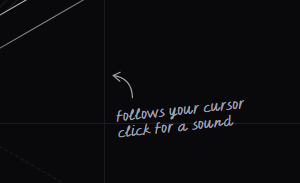
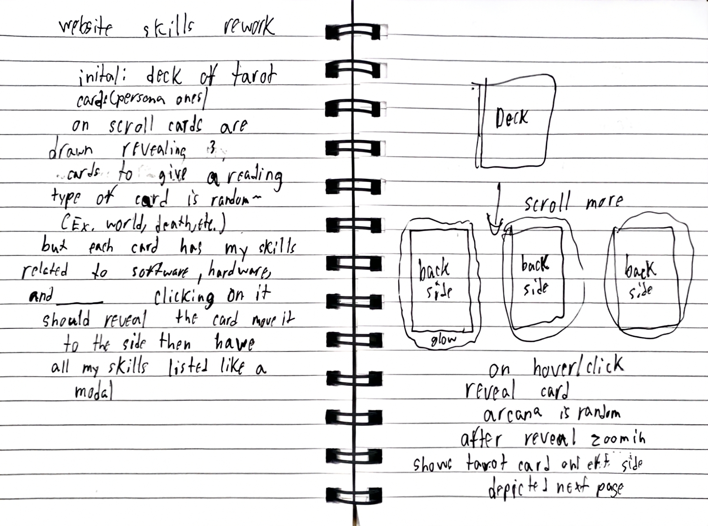
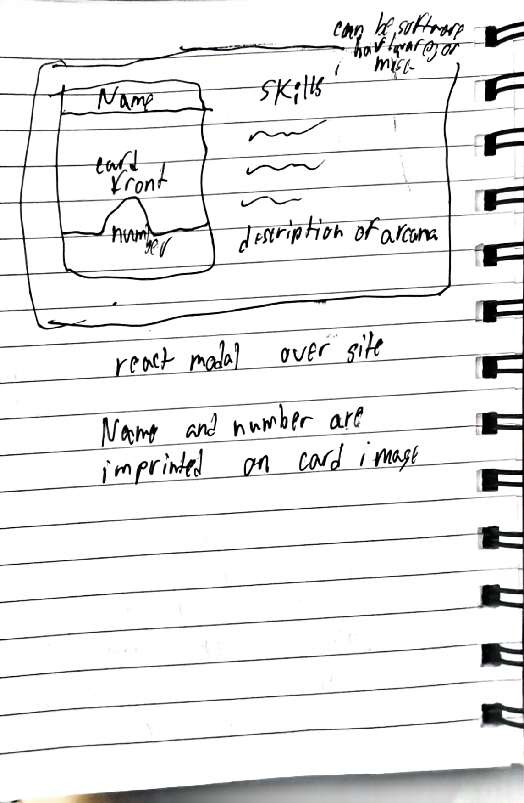

Currently the skills frontend is too bland let's rework it

# Skills Rework (From Web cards to Actual Tarot Cards)

## Placement

It will still be below the about me, but the inital state will be closer than the final state

## Summary of plans

Initial: deck of tarot cards(persona 3 ones) vertically placed only the backsides are shown  
Then on scroll they shuffle and deal out 3 cards faced down, the deck is still in view just tinier and horizontal(click on it to redeal out 3 cards)

The cards dealt out have a fading in and out outer blue(only on home page, so secondary-color) glow on hover/click they are flipped to reveal the arcana this then opens a react modal

On react modal open it has the card go big in the center then moves to the side to reveal the description and skills. The skills listed are all the same no matter the arcana drawn. The skills shown will be Software, Hardware, and Misc skills one on each card(which skill categories are shown need to be thought a bit more).

Just in case it's not clear to click or hover on it to reveal the card have a unobtrusive hint thats says "Click on a card to reveal it's true form". Like this


After all cards are revealed have it give a tarot reading(not a priority will skip for now unless clean formula for tarot reading)

## Handwritten notes for more clarity




## Implementation specifics

The backside of all cards will be the same image, the front side will be a randomly drawn arcana(same name as image png) that are all in the same folder with an object that lists their characteristics like so:

```ts
type Arcanas = {
  image: string;
  name: string; // might be useless
  description: string;
  /*
    //if tarot cards have clear formula
    firstDef:string;
    secondDef:string;
    thirdDef:string;
    // basically what they mean when their drawn as that card.
    */
  major: boolean; // major arcana true, minor false
};
```

## Tarot Card Research

- Card 1: The Past  
  these are Past events that still affect you  
  Past events that are either holding you back or have the potential to help you
  Basically reflection on the Past and what's still lingering in your thoughts
- Card 2: The Present  
  Your current situation and present challenges
- Card 3: The Future  
  What direction things are moving in  
  The outcome of the present situation

Apparently tarot reading represents a specific question, focus, or situation you want more clarity on. Therefore, your cards represent the past, present, and future as it relates to your question. Which means I'll need an LLM or GenAI if I want to give an actual reading
